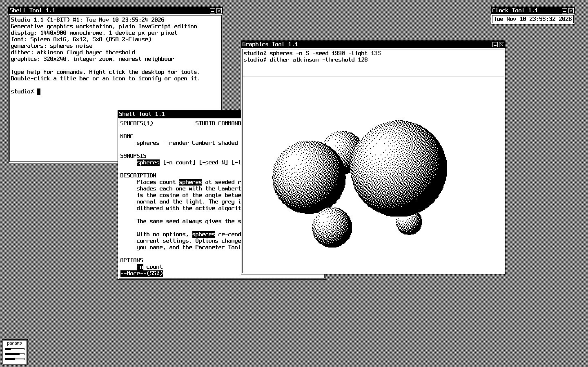

# Studio 1.1

A generative art studio in the browser that looks and behaves like a 1990 monochrome workstation running SunView. It renders shaded spheres and noise fields at 320x240, dithers them to pure black and white, and exports 1-bit PNG files.

Studio is plain HTML, CSS, and JavaScript modules. It has no build step and no dependencies.



## Run it

Serve the folder over HTTP. Opening `index.html` from the file system does not work, because the browser blocks `fetch` for the bundled fonts.

```sh
python3 -m http.server 8000
```

Then open <http://localhost:8000>. `npx serve` also works.

To force a pixel size, add `?scale=N`, where N is the number of device pixels per screen pixel, from 1 to 8. For example, `http://localhost:8000/?scale=3`.

## Use the desktop

- Drag a window by its title bar. An outline follows the pointer, and the window moves when you release the button.
- Click a window to bring it to the front.
- To iconify a window, double-click its title bar or click the small box button. Double-click an icon, or focus it and press Return, to open it again.
- Click the X button to close a tool.
- Right-click the desktop for the Studio menu. It opens any tool and has **Open All** and **Iconify All**. With the keyboard, focus the desktop and press Shift+F10.
- Right-click a title bar for the frame menu: **Iconify**, **Front**, **Back**, and **Quit**. The Graphics Tool adds **Zoom 1x**, **Zoom 2x**, and **Zoom 3x**. The Shell Tool adds **Clear**.

The tools:

- **Shell Tool** is the command line. Open as many as you like.
- **Graphics Tool** shows the picture, with a log of the commands that produced it. Drop an image file on it to dither the image.
- **Parameter Tool** has sliders and drop-downs for the same settings the commands change. It starts as an icon at the bottom left.
- **Clock Tool** shows the date and time.

## Shell commands

| Command | What it does |
| --- | --- |
| `help` | Lists the commands. |
| `ls` | Lists the commands and generators, plus any dropped image. Generators end in `*`. |
| `clear` | Clears the window and its scrollback. Control-L does the same. |
| `man <command>` | Shows the manual page. Long pages stop at `--More--`. |
| `spheres [-n count] [-seed N] [-light angle]` | Renders Lambert-shaded spheres. `-n` is 1 to 24, `-seed` is 0 to 9999, `-light` is 0 to 359 degrees counter-clockwise from 3 o'clock. |
| `noise [-seed N] [-scale N] [-oct N]` | Renders a seeded gradient-noise field. `-scale` is the feature size in pixels, 4 to 160. `-oct` is the number of octaves, 1 to 6. |
| `dither <atkinson\|floyd\|bayer\|threshold> [-threshold N]` | Sets the dithering algorithm and re-renders. `-threshold` is 0 to 255. With no arguments, prints the current setting. |
| `export [-scale N]` | Downloads the picture as a 1-bit PNG, scaled by a whole number from 1 to 16. The default is 2. |
| `image` | Switches back to the last dropped image. |
| `history` | Lists the commands typed in this window. |
| `date` | Prints the date and time. |
| `echo [text ...]` | Prints its arguments. |
| `exit` | Closes this Shell Tool. |

A command with no options re-renders with the current settings. Options change only the settings you name.

Keys in the Shell Tool:

| Key | Action |
| --- | --- |
| Up, Down | Step through history. |
| Tab | Complete a command name, a `man` page, or a `dither` algorithm. On an empty line, Tab moves focus out of the terminal. |
| Space, Return, q | At `--More--`: next page, next line, stop. |
| Page Up, Page Down, mouse wheel | Scroll back through earlier output. |
| Control-A, Control-E | Go to the start or the end of the line. |
| Control-U, Control-K | Delete to the start or to the end of the line. |
| Control-W | Delete the previous word. macOS only, because other systems reserve Control-W to close the tab. |
| Control-C | Cancel the line. With text selected, Control-C or Command-C copies it. |
| Command-K | Clear the window. |

Drag across text to select it in inverse video. Double-click a word to select the word.

## How it renders

All text, icons, and graphics come from 1-bit bitmaps. Window borders are CSS lines in pure black. `js/gfx/bitmap.js` stores pixels as 0 or 1 and draws lines, circles, and text into them. `paint()` copies a bitmap into a `<canvas>` at 1:1, and CSS scales the canvas by a whole number with `image-rendering: pixelated`. The interface never uses the browser's text rendering, so no smoothed font can appear.

One screen pixel is `k` device pixels, where `k` is the device pixel ratio rounded to a whole number. `js/core/scale.js` sets the CSS variable `--px` to the size of one screen pixel, and all layout sizes are multiples of it. On a 1440x900 display at 2x, the desktop is 1440x900 screen pixels, close to the 1152x900 of the original hardware.

The picture pipeline in `js/pipeline.js` has two steps:

1. The active generator renders a grey buffer of 320x240 values from 0 (black) to 1 (white).
2. `dither()` in `js/dither.js` turns that buffer into 1-bit pixels.

The pipeline caches the grey buffer, so moving the threshold slider only re-dithers.

`js/core/store.js` holds the settings. The Shell Tool and the Parameter Tool both write to the store and both redraw when it changes, so they stay in sync.

## Add a generator

A generator is one file in `js/generators/` that exports this object:

```js
export default {
	name: 'rings',
	summary: 'render concentric rings',
	description: ['One paragraph per string, used by the man page.'],
	params: [
		{ key: 'count', flag: 'n', label: 'Count', arg: 'count', min: 1, max: 40, default: 12, doc: 'Number of rings.' },
	],
	render(params, w, h) {
		// Return a Float32Array of w*h grey values, 0 = black, 1 = white.
	},
};
```

Import it in `js/generators/index.js` and add it to the `generators` array. The shell command, its flags, its man page, and its Parameter Tool sliders come from this object.

## Project layout

```text
index.html
docs/screenshot.png         the screenshot in this README
css/studio.css              1-bit styles, frames, menus, panel layout
fonts/                      Spleen BDF fonts and their licence
js/main.js                  boot, root menu, opening layout
js/core/                    scale.js, store.js, rng.js, time.js
js/gfx/                     bitmap.js, font.js (BDF parser), desktop.js (pattern and cursor)
js/ui/                      draw.js (text and glyph helpers), widgets.js (slider, choice, button)
js/wm/                      wm.js (frames, icons, dragging), menu.js (pop-up menus)
js/dither.js                Atkinson, Floyd-Steinberg, Bayer 8x8, threshold
js/generators/              spheres.js, noise.js, index.js (registry)
js/pipeline.js              grey buffer, dithering, image loading
js/export-png.js            1-bit PNG encoder and download
js/tools/                   graphics.js, params.js, clock.js, index.js (registry)
js/tools/shell/             terminal.js (screen), shell.js (editing, pager), commands.js
```

## Decisions

- **Font.** Spleen 2.1.0 by Frederic Cambus, BSD 2-Clause licence, in `fonts/LICENSE-spleen.txt`. Studio loads the BDF files and parses them at runtime. The 8x16 size is for text, 6x12 and 5x8 are for icon labels.
- **Window dragging.** Studio drags an outline and moves the window on release, as SunView did.
- **Title bar buttons.** SunView had none. Studio adds an iconify box and a close button, so these actions do not depend on a double-click or a menu.
- **Threshold.** The threshold control works the same way for all four algorithms. It shifts the grey level that falls on the black and white split, so a higher value darkens the picture.
- **Spheres.** Light comes in 55 degrees above the picture plane, and the brightest highlight stops just short of white. Every sphere keeps a stippled edge against the white field as a result.
- **Dropped images.** Studio fits the whole image into 320x240 on a white background and dithers the Rec. 601 luma of the sRGB values. Linear-light values crushed the darker third of a test gradient to solid black.
- **Export.** The PNG has a bit depth of 1, so it can only hold black and white. Browsers without `CompressionStream` fall back to an RGBA PNG that still holds only two colours.
- **Opening layout.** The windows start in the arrangement of a typical SunView screen from 1990. Two Shell Tools overlap, one stopped at `--More--`. The Graphics Tool sits on the right, the Clock Tool at the top right, and one icon at the bottom left.
- **Artwork.** All icons, glyphs, and the cursor are drawn in code for this project. Studio uses no Sun artwork or logos.

## Limits

- At whole-number device pixel ratios (1x, 2x, 3x), every screen pixel is pure black or white. At fractional ratios, such as 150% display scaling or browser zoom, the browser's layout rounding blends some window edges to grey. Set the browser zoom to 100% on a display at a whole-number ratio to avoid the blending.
- Windows cannot be resized.
- The Shell Tool needs a physical keyboard. Phones and tablets are not supported.
- Settings and history reset when the page reloads.
- Studio has been tested in Chrome only.

## Licence

The code in this repository has no licence yet. The Spleen fonts in `fonts/` are under the BSD 2-Clause licence in `fonts/LICENSE-spleen.txt`.
